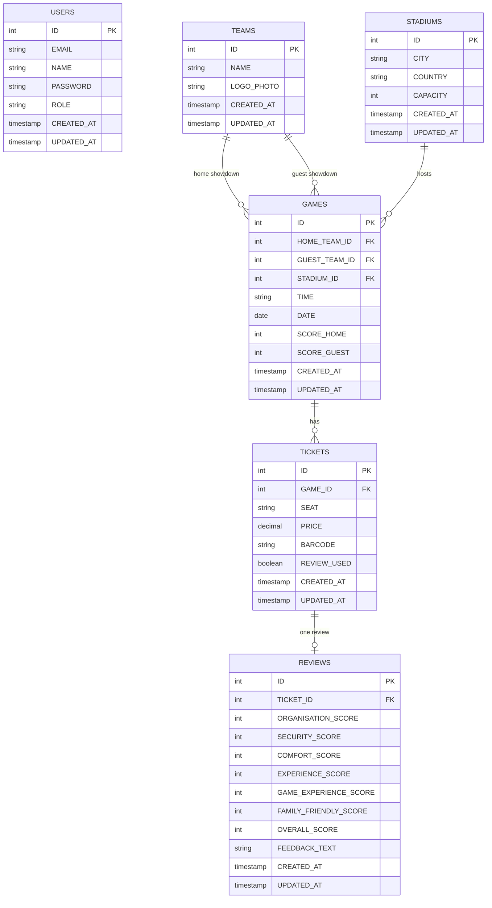

<style>
  h1, h2,
  .vscode-light h1, .vscode-light h2,
  .vscode-dark h1, .vscode-dark h2,
  .vscode-high-contrast h1, .vscode-high-contrast h2 {
    border-bottom: none !important;
  }
</style>


# FanAnalitic

FanAnalitic collects what supporters actually felt at a match, then turns those answers into statistics and conclusions.

A fan does not create an account. The ticket already carries a QR code. Scanning it opens a short form for that specific match. The fan rates the experience and leaves a short comment. Each ticket can be used once. From those responses we can see how a match, a stadium, or a club is experienced: security, comfort, organisation, how family-friendly it felt, and the overall impression.

## How it works

1. A ticket is issued for a game and stores a barcode, which is printed as a QR code.
2. During the match the fan scans the code and lands on a simple form tied to that ticket and that game.
3. The form asks for scores and a short written impression.
4. The answer is stored as one review. The ticket is marked as already used, so the same code cannot be submitted again.
5. Reviews are aggregated in Snowflake into statistics and conclusions across games, teams, and stadiums.

Staff use a separate admin panel on the same Next.js app. They sign in with email and password. Passwords are hashed with bcryptjs, and each session is verified with a JWT. From the panel they follow analytics and manage the catalog: teams, stadiums, games, and the rest of the match data.

## Stack

<table border="1" cellpadding="8" cellspacing="0" style="border-collapse: collapse; width: 100%;">
  <thead>
    <tr>
      <th align="left" style="border: 1px solid #888; padding: 8px 12px;">Part</th>
      <th align="left" style="border: 1px solid #888; padding: 8px 12px;">Technology</th>
      <th align="left" style="border: 1px solid #888; padding: 8px 12px;">Role</th>
    </tr>
  </thead>
  <tbody>
    <tr>
      <td style="border: 1px solid #888; padding: 8px 12px;">Frontend (Web app)</td>
      <td style="border: 1px solid #888; padding: 8px 12px;">Next.js</td>
      <td style="border: 1px solid #888; padding: 8px 12px;">Fan form from the QR code, and the admin panel</td>
    </tr>
    <tr>
      <td style="border: 1px solid #888; padding: 8px 12px;">Backend</td>
      <td style="border: 1px solid #888; padding: 8px 12px;">Express.js</td>
      <td style="border: 1px solid #888; padding: 8px 12px;">Tickets, reviews, games, and admin actions</td>
    </tr>
    <tr>
      <td style="border: 1px solid #888; padding: 8px 12px;">Auth</td>
      <td style="border: 1px solid #888; padding: 8px 12px;">JWT, bcryptjs</td>
      <td style="border: 1px solid #888; padding: 8px 12px;">Login verification and password hashing for admin users</td>
    </tr>
    <tr>
      <td style="border: 1px solid #888; padding: 8px 12px;">Warehouse</td>
      <td style="border: 1px solid #888; padding: 8px 12px;">Snowflake</td>
      <td style="border: 1px solid #888; padding: 8px 12px;">Storage and analysis of review data</td>
    </tr>
  </tbody>
</table>

## Starting data model

Fans are not a user account: a review hangs off a ticket. `USERS` holds admin accounts and is not linked to reviews.



## Repository

```
FanAnalitic/
  frontend/     Next.js app
  backend/      Express API
    src/
      config/
      controllers/
      middleware/
      models/
      routes/
      services/
      utils/
```

## Dashboard API

See [Visualization and endpoint guide](./VISUALISATION_INTRO.md) for the implemented analytics routes, filters, response contracts, and recommended charts. [Snowflake schema](./SNOWFLAKE_SCHEMA.md) describes the warehouse sources.

Start the API with `cd backend`, `npm install`, then `npm run dev` after configuring Snowflake credentials in `backend/.env`. Run backend checks with `npm test`.
